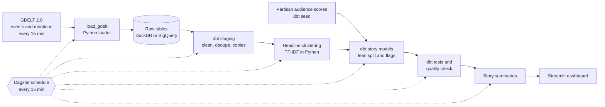
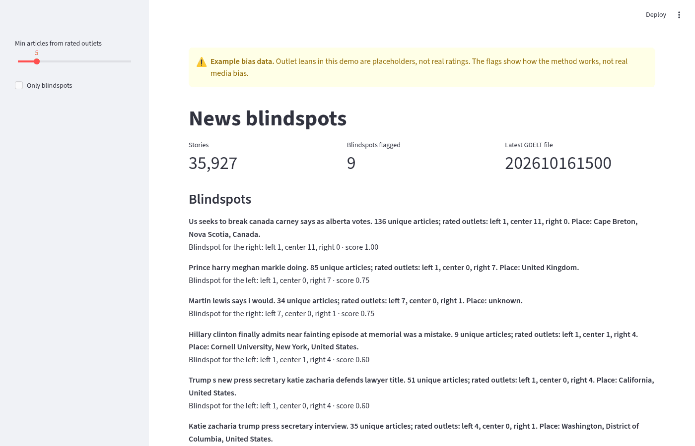
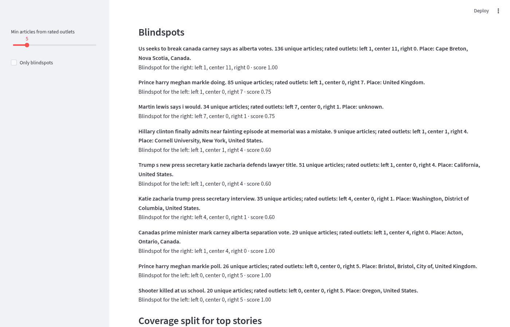
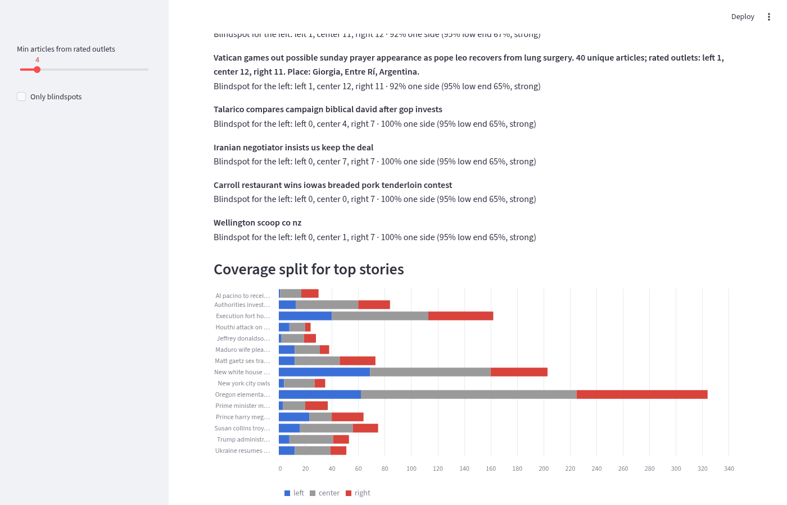
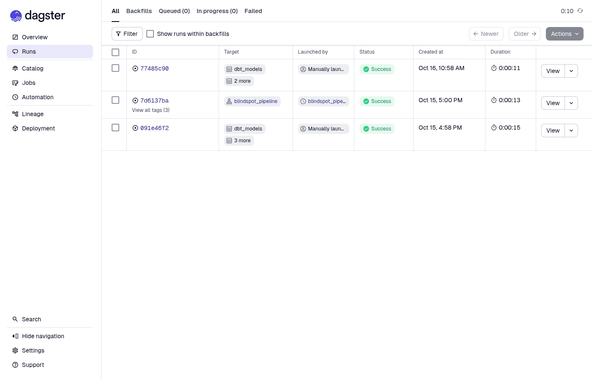
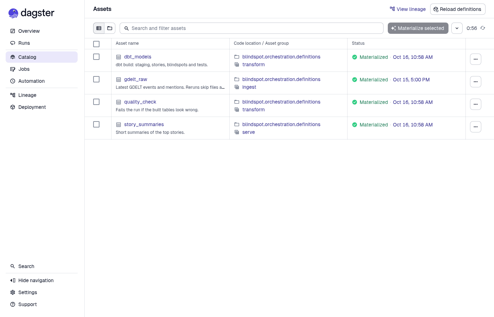
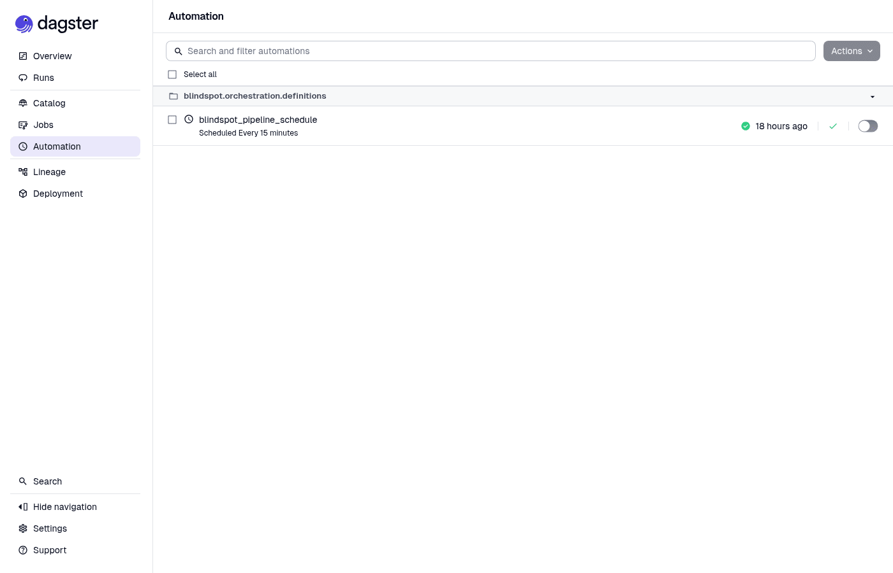

# news-blindspot-pipeline

**A working data pipeline that finds news stories one side of the political spectrum is ignoring, refreshed every 15 minutes from public GDELT data.**

## The problem
When a big story breaks, outlets on the left and right often cover it very differently, and sometimes one side barely covers it at all. Those gaps are called blindspots. This project is a small, working pipeline that finds them in public news data, end to end: pull the data, group articles into stories, count coverage by outlet lean, and show the results on a dashboard.

It's a prototype I built to understand the problem properly. Every number below comes from a real run, and the limits section says plainly what still falls short.

## What it does
For every news story in the last day, answer three questions:
1. Who covered it, and how many unique articles were there?
2. How did the coverage split between left, center and right outlets?
3. Is one side mostly ignoring it?

And keep the answers fresh every 15 minutes, with tests that stop bad numbers before anyone sees them.

## Data source
[GDELT 2.0](https://www.gdeltproject.org/) watches news sites around the world and publishes two files every 15 minutes:
- **Events**: who did what to whom, where, coded with CAMEO event codes.
- **Mentions**: every article that mentioned an event, with the outlet and the URL.

It's free and public, and a day is roughly 120k events and 300k mentions from almost 5,000 outlets.

Outlet lean comes from the **partisan audience scores** published by Robertson et al. (2018), see [Outlet lean](#outlet-lean) below.

## Architecture



If any step fails, the steps after it don't run, so bad numbers never reach the dashboard.

## Stack
| Layer | Tools |
|---|---|
| Language | Python 3.12 |
| Warehouse | DuckDB locally, BigQuery in the cloud (same code and models) |
| Transformations | dbt Core with dbt-duckdb and dbt-bigquery |
| Story clustering | scikit-learn TF-IDF, SciPy connected components |
| Orchestration | Dagster |
| Dashboard | Streamlit, pandas |
| Summaries | Extractive by default, optional Gemini on Vertex AI |
| Testing | dbt tests, a Python quality check, pytest |
| Runtime | Docker and Docker Compose |

## How we pull the data
`python -m blindspot.ingest.load_gdelt --hours 24`
- It works out the 15 minute file names for the window from GDELT's `lastupdate.txt`, so it never downloads the huge master file list.
- Every loaded file is recorded in a `_load_manifest` table. Running it again only fetches new files.
- For each file it deletes that file's rows and then inserts them, so a file that half loaded before is replaced, not doubled.
- `--end` pins the window, which lets you compare two runs row for row.
- The same code writes to DuckDB on your laptop or to BigQuery (`WAREHOUSE=bigquery`). The BigQuery raw tables are clustered on the source file, so these per file deletes stay cheap.

## Transformations
Everything after the load runs with one command, `python -m blindspot.build`, in three parts: dbt staging, headline clustering in Python, then the rest of dbt. The dbt project runs unchanged on DuckDB and BigQuery.

**Staging (dbt).** GDELT dates like `20261015193000` become real timestamps, duplicates are removed, and only web articles are kept. On BigQuery, staging tables are split into daily partitions, so a query over the last few days only reads those days.

**Article copies (dbt).** Syndication networks post one article on hundreds of sites. Copies share the same URL slug, so a slug seen on 3 or more sites is treated as one article.

**Stories (Python, `blindspot.stories.cluster`).** Most news URLs end in the headline, so we turn slugs back into headlines and group them:
1. Turn each unique article's headline into a TF-IDF vector (words and word pairs, English stop words removed).
2. Link two headlines when their cosine similarity is at least 0.5 and they were first seen within 36 hours of each other.
3. Each connected group of links is a story. Its label is the headline closest to the group's average vector.

I tuned the 0.5 on this data:
- At 0.3 and 0.4, unrelated stories chain into one giant group (13,715 headlines at 0.3).
- At 0.6, real stories split apart.
- At 0.5, the biggest group is the Oregon school shooting, with 268 headlines.

Articles whose URL has no headline words (like `/article/12345`) join the headline story that shares the most GDELT events with them. Whatever is left keeps an event based grouping. Those stories are kept out of flags and summaries, because there is no headline to check them against.

**Outlet lean.** See below. dbt buckets each outlet's score into left (score of -0.2 or less), right (0.2 or more) or center (in between). Both cut offs are dbt vars.

**Blindspots (dbt).** For each story we count unique articles by lean. A syndicated article counts once per lean. A story is flagged when:
- it was grouped by headline,
- it has **at least 4 left plus right articles**, and
- one side has **80% or more** of them.

Each flag also carries a 95% Wilson interval on that share:
- **strong**: the low end of the interval is still above 50%.
- **weak**: anything else that meets the rule.

## Outlet lean
Lean comes from:

> Robertson, R. E., Jiang, S., Joseph, K., Friedland, L., Lazer, D., & Wilson, C. (2018). Auditing Partisan Audience Bias within Google Search. *Proceedings of the ACM on Human-Computer Interaction*, 2(CSCW), 148. https://doi.org/10.1145/3274417

The data is "Partisan Bias Scores for Web Domains" on Harvard Dataverse (https://doi.org/10.7910/DVN/QAN5VX), released under **CC0 1.0**. The authors ask that you cite the paper.

What the scores are:
- About 19,000 domains, each scored from -1 (shared only by registered Democrats on Twitter) to 1 (shared only by registered Republicans).
- They describe **who shares an outlet**, not how the outlet writes. They come from 2017 Twitter data.
- We keep only the authors' own `score` column. The file also includes scores from other projects (AllSides, Pew, Budak et al.) that have their own terms, so we leave those out.
- `scripts/fetch_partisan_scores.py` rebuilds the seed from the source.

## Data quality
Checks run on every build:
- Freshness on the raw tables: warn after 2 hours with no new data, error after 6.
- Row counts that must match between raw and staging.
- Share of mentions that join to a loaded event (warns below 80%).
- Scores, shares and interval bounds stay between 0 and 1, lean counts add up, and every flag meets the rule and says which side is missing.
- `python -m blindspot.quality.check` looks over the final tables and exits with code 1 if anything is off, so the scheduled run stops there.

## Summaries
`python -m blindspot.summaries.run --top 20` writes a one line summary for the top stories.
- By default it leads with the story's most central headline from clustering, then adds the article count and lean split. No key needed, and it can't make anything up.
- `SUMMARY_MODE=vertex` asks Gemini on Vertex AI for one neutral sentence from the story's headlines, and falls back to the default if the call fails. The Vertex AI API is not enabled in our project yet, so every summary in the results is the default kind.
- Every summary is checked for length, URLs, mention of the place or actors, and **coherence**: how many of the story's headlines share wording with it.

## Orchestration with Dagster
Six assets run in order every 15 minutes:
1. `gdelt_raw`
2. `dbt_staging`
3. `headline_clusters`
4. `dbt_models` (the story models plus tests)
5. `quality_check`
6. `story_summaries`

If a step fails, the steps after it don't run, so a bad load never reaches the dashboard. Each run loads the last hour of files and skips what's already there, so missed runs catch up on their own.

## Dashboard
A small Streamlit app with:
- a note on where outlet lean comes from
- story and blindspot counts
- the flagged stories sorted by confidence
- a left / center / right bar chart for the top stories
- a table you can filter

It opens the database read only, so it never blocks the pipeline.

## Results
From a fresh run on the pinned window Oct 15, 11:15 AM ET to Oct 16, 11:00 AM ET (`--end 20261016150000`). Full numbers are in [results/summary.md](results/summary.md).
- 192 files, 118,290 events, 310,068 mentions, 4,895 outlets.
- 50,393 article URLs collapse to 32,914 unique articles. One story was posted on 642 sites.
- 23,872 headlines cluster into 18,063 headline stories, and 5,656 more articles join them through shared events. 23,175 stories in all.
- 42% of mentions come from an outlet with a lean score.
- 137 stories have enough left plus right coverage to judge. **71 are flagged** (47 a blindspot for the left, 24 for the right), and 49 of them are strong.
- Summary eval:
  - before clustering: 2 of 20 passed, average coherence 0.14
  - after: **19 of 20, average 0.99**, and 89 of the top 100 pass (0.95). The one top 20 miss is coherent but has no place or actor in GDELT.
- dbt 20 of 20 passed, freshness passed, quality check passed.
- BigQuery on the same window gives the same raw counts, the same stories and **the same 71 flagged story ids**.








## Final verdict
The pipeline works end to end and is ready to build on.
- **Reliable:** a fresh run from an empty database loads all 192 files with no rows rejected, and dbt passes 20 of 20.
- **Reproducible:** reruns and BigQuery both give the same 71 flagged story ids as DuckDB.
- **Useful signal:** headline clustering lifted summary coherence from 0.14 to 0.99 on the top 20 stories, and lean coverage went from about 1% to 42% of mentions.
- **Not done yet:** the flags are only as good as the lean data. Audience scores from 2017 push many local and soft news stories into the list, so a hard news filter is the next thing to build before these flags would be shown to readers.

## Honest limits
- **Audience lean is not content slant.** A score says who shared an outlet on Twitter in 2017. Some outlets move, and a few odd ones stand out: AP scores left (-0.33) and CNN scores center (-0.12).
- **Flags lean toward local and soft news.** Many local radio and TV sites have right leaning audiences in this data. So stories like an Iowa pork tenderloin contest come out as a "blindspot for the left". That's what the audience data says, but it isn't the hard news gap a reader means by a blindspot.
- **Place labels can be off.** The place is the one GDELT names most often across a story's articles. Sometimes it's wrong, for example a story about the Pope placed in Argentina.
- **Slugs aren't perfect headlines.** Capitals and apostrophes are lost, and a few slugs aren't headlines at all ("Wellington scoop co nz").
- **About 8% of articles can't be placed by headline**, so they keep the coarser event grouping. They're left out of flags and summaries.
- **DuckDB has one writer.** Fine for a laptop. In production the dashboard would read from BigQuery.

## How to run with Docker
You only need Docker Desktop.

```bash
git pull
docker compose up --build dagster dashboard
```

- Dagster: http://localhost:3000
- Dashboard: http://localhost:8501
- Stop with Ctrl+C, then `docker compose down`.
- Add `SCHEDULE_ON=0` in front to keep the 15 minute schedule off.

On a first run the database is empty. You can load and build by hand:

```bash
docker compose run --rm pipeline python -m blindspot.ingest.load_gdelt --hours 24
docker compose run --rm pipeline python -m blindspot.build
docker compose run --rm pipeline python -m blindspot.quality.check
docker compose run --rm pipeline python -m blindspot.summaries.run --top 20
docker compose run --rm pipeline pytest
```

Compose rebuilds the image whenever you run it, so pulled changes to dependencies are always picked up. If anything looks stale, run `docker compose build --no-cache`.

**BigQuery.** Keep the service account key outside the repo and point `GCP_KEY_PATH` at it. It's mounted read only and never copied into the image.

```bash
export GCP_KEY_PATH=$HOME/.secrets/gcp-groundnews.json
export GCP_PROJECT=your-project
WAREHOUSE=bigquery docker compose run --rm pipeline python -m blindspot.ingest.load_gdelt --hours 24
DBT_TARGET=bigquery docker compose run --rm pipeline python -m blindspot.build
```

`BQ_DATASET` picks the raw dataset (default `raw_gdelt`), and models go to `analytics`.

## Next steps
1. Add a hard news filter (for example by CAMEO event type or a topic model), so blindspots focus on stories a reader would call news.
2. Compare the audience scores with a newer source as one becomes openly available, and track drift per outlet.
3. Turn on Gemini summaries once the Vertex AI API is enabled, and keep the same checks.
4. Run the schedule in the cloud (Cloud Run jobs and Cloud Scheduler) with the dashboard reading from BigQuery.

## Project structure
```
news-blindspot-pipeline/
├── src/blindspot/
│   ├── ingest/          GDELT loader, file manifest, DuckDB and BigQuery backends
│   ├── stories/         TF-IDF headline clustering
│   ├── quality/         final table checks that stop a bad run
│   ├── summaries/       extractive and Vertex AI summaries, plus the eval
│   ├── orchestration/   Dagster assets and the 15 minute schedule
│   ├── build.py         dbt staging, clustering, then the story models
│   └── warehouse.py     shared warehouse connection
├── dbt/
│   ├── models/staging/  clean events, mentions and syndicated copies
│   ├── models/stories/  stories, outlet lean, coverage split and blindspots
│   ├── seeds/           partisan audience scores (CC0)
│   └── tests/           rule, range and row count tests
├── dashboard/app.py     Streamlit dashboard
├── scripts/             rebuilds the lean seed from the source
├── tests/               pytest unit tests
├── results/summary.md   full numbers from the pinned run
├── docs/images/         dashboard and Dagster screenshots
├── Dockerfile
└── docker-compose.yml
```

## Author
**Manish Reddy**, data engineer
- Email: [manishreddyr998@gmail.com](mailto:manishreddyr998@gmail.com)
- GitHub: [manishreddy998](https://github.com/manishreddy998)

## License
[MIT](LICENSE). The partisan audience scores are CC0 1.0 from Robertson et al. (2018).
