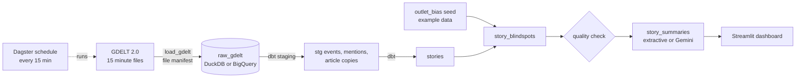

# news-blindspot-pipeline

A small data pipeline that tracks how news stories are covered across the political spectrum and flags blindspots: stories that get heavy coverage from one side and little from the other.

It pulls public news data from [GDELT](https://www.gdeltproject.org/), groups articles into stories, joins outlet bias ratings and scores the coverage split per story. Stack: Python, DuckDB for local runs, BigQuery, dbt, Pub/Sub and Dagster.

**Status:** work in progress. Pieces get added one at a time.

## How it fits together



Dagster runs the whole chain every 15 minutes: load the last hour of files (already loaded files are skipped), `dbt build` with its tests, the Python quality check, then summaries. If any step fails, the later ones don't run.

## Running everything

```bash
docker compose up --build dagster dashboard
```

Compose also rebuilds on its own (`pull_policy: build`), so after a `git pull` you always run the current dependencies. If something still looks stale, run `docker compose build --no-cache`.

- Dagster UI: http://localhost:3000 (the 15 minute schedule starts on its own; set `SCHEDULE_ON=0` to keep it off)
- Dashboard: http://localhost:8501

Stop with Ctrl+C, then `docker compose down`.

One off commands:

```bash
docker compose run --rm pipeline python -m blindspot.quality.check
docker compose run --rm pipeline python -m blindspot.summaries.run --top 20
```

Summaries default to an extractive method built from article headlines. `SUMMARY_MODE=vertex` uses Gemini on Vertex AI if the API is enabled in your project, and falls back to extractive if the call fails.

## Running with Docker (recommended)

You only need Docker Desktop. Nothing gets installed on your machine.

```bash
docker compose build
docker compose run --rm pipeline pytest
docker compose run --rm pipeline python -m blindspot.ingest.load_gdelt --hours 24
```

Data lands in `./data` on your machine, so it survives between runs.

To load into BigQuery, point `GCP_KEY_PATH` at your service account key. It is mounted read only at `/secrets/gcp.json` and never copied into the image.

```bash
export GCP_KEY_PATH=$HOME/.secrets/gcp-groundnews.json
WAREHOUSE=bigquery GCP_PROJECT=groundnews-prototype \
  docker compose run --rm pipeline python -m blindspot.ingest.load_gdelt --hours 24
```

Rebuild after pulling changes that touch `pyproject.toml`: `docker compose build`.

## Building the story models (dbt)

```bash
docker compose run --rm -w /app/dbt pipeline dbt build --profiles-dir .
```

This turns the raw tables into `stories` and `story_blindspots`. For BigQuery, set `GCP_KEY_PATH` as above and run it with `DBT_TARGET=bigquery GCP_PROJECT=groundnews-prototype` in front. Models land in the `analytics` dataset, with staging tables split into daily partitions.

Note: `dbt/seeds/outlet_bias.csv` is example data so the joins have something to work with. It is not a real bias rating and should be replaced with a licensed source before anyone reads the results as fact.

## Running the ingest without Docker

```bash
pip install -e ".[dev]"
python -m blindspot.ingest.load_gdelt --hours 24
pytest
```

This pulls the last 24 hours of GDELT 2.0 Events and Mentions files (one of each every 15 minutes) into `data/blindspot.duckdb` as `raw_gdelt_events` and `raw_gdelt_mentions`. A `_load_manifest` table records every file loaded, so running it again only fetches new files.

To load into BigQuery instead, install `.[bigquery]` and set:

```bash
export WAREHOUSE=bigquery
export GCP_PROJECT=your-project
export GOOGLE_APPLICATION_CREDENTIALS=/path/to/key.json
export BQ_DATASET=raw_gdelt   # optional
```
